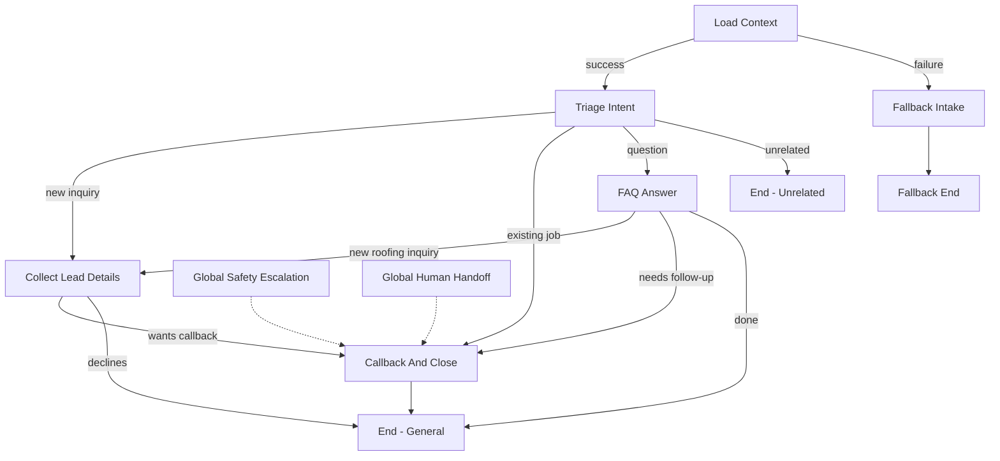

# Engineering Notes #02 — Retell Composer agent architecture

**Reviewed:** the privately shared *Retell Summit Roofing Receptionist v2.json* export, alongside our existing FastAPI backend. The original export stays private and is **not** committed to GitHub.

## The big picture

Retell handles the **conversation**. FastAPI handles **business operations and rules**. PostgreSQL stores durable records.

- **16 nodes**, including **2 global escalation nodes**
- **7 custom functions**, all pointing to the staging Railway API
- **7 post-call analysis fields** for intent, issue, urgency, eligibility, intake, callback and outcome
- **Exported version 2 is marked unpublished** and has no assigned tags / agent ID. This does not tell us which version is answering calls right now.

## What a caller can actually reach



**Important:** the five nodes `check_eligibility`, `explain_not_eligible`, `book_appointment_flow`, `check_booking_status`, and `end_booked` are not reachable through any current start/global path. In particular, **there is no edge from `collect_lead_details` to `check_eligibility`**.

This matches the staging prompt, which deliberately disables booking and transfers. It is not a broken live booking system; it is **booking scaffolding that has not been activated**.

## Tools: configured versus reachable

| Function | Reachable by the v2 conversation? | What our Python backend does |
| --- | --- | --- |
| `get_business_context` | Yes | Loads configured business facts and feature flags |
| `save_lead` | Yes | Persists a lead and returns a `lead_id` |
| `request_callback` | Yes | Creates a **queued** callback request, not an email or phone call |
| `check_service_eligibility` | No | Applies deterministic coverage and intake rules |
| `get_available_appointments` | No | Offers slots only if eligible and booking enabled |
| `book_appointment` | No | Creates and reconciles an appointment operation |
| `get_booking_status` | No | Checks a prior operation instead of rebooking |

The seven exported URLs match the staging host and path structure `https://api-staging-dce8.up.railway.app/v1/retell/tools/…`. The webhook is pointed to `/v1/retell/webhooks`. Primary parameter names and declared required fields align with `app/contracts.py`.

**Still unverified:** whether the currently active Retell agent sends the correct signed POST envelope, whether response variables populate at runtime, and whether this exported version is actually taking test calls. A browser returning HTTP 200 at `/ready` does not prove any of these.

## The two global nodes

**Safety Escalation** detects immediate danger and advises getting to safety and contacting emergency services, rather than giving repair instructions.

**Human Handoff** responds to requests for a person or frustration. The current node explicitly offers **a callback instead of a live phone transfer**. Before real transfers, map `data.transfer_phone_number` from `get_business_context` and gate the transfer on approved business configuration.

## Staging restrictions

`app/business.staging.json` intentionally provides no approved services, hours, service-area coverage or FAQs. `booking_enabled` and `transfer_available` are false.

The global prompt respects these restrictions. The agent should not claim approved services, prices, licenses, warranties, booking times, or callback deadlines without verified business data. This is why we can test the **lead + callback** route now without pretending appointments are real.

A successful `request_callback` only proves a row was queued in the database. **No person has necessarily been notified.** A real dispatcher is a pilot milestone.

## Privacy / operations checklist

The exported agent has Retell data storage set to `everything`, empty PII redaction categories, contact memory reading enabled, and a 60-minute maximum call duration. Before using real customer calls, review recording notice and consent, retention, access controls, PII redaction and memory policies.

The Python webhook worker handles the `call_started`, `call_ended` and `call_analyzed` events. It currently stores limited event metadata rather than a full operations dashboard or a delivered callback message.

## Demo-first next steps

1. **Verify actual Retell version.** Exported v2 is unpublished, so check the selected version/tag in the dashboard.
2. **Place one staging test call.** Confirm a signed `POST /v1/retell/tools/get_business_context` reaches Railway and returns 200. Validate the `context_ok` transition.
3. **Test one fictional lead.** Confirm `save_lead` returns `ok: true` with `data.lead_id`. Confirm `request_callback` returns `ok: true` and `data.status: queued`.
4. **Test safety and errors.** Missing approved FAQs, immediate danger, request for a human, and unavailable backend must not produce invented promises.
5. **Fix deployment automation.** Railway's reported running API deployment predates recent GitHub merges. Review the existing GitHub CI failures before relying on automated deployment.
6. **Build a simple call-outcome view** once the signed path works. Demonstrate intake, follow-up, and meaningful logs.

### Pilot-ready follow-up

Add office notifications with retries, a real provider-backed calendar, approval of each roofer's hours/services/service area, an operator view, and callback delivery monitoring. Only then connect **confirmed intake → eligibility → availability → explicit confirmation → booking** and permit real booking claims.

### Template at scale

Retain one versioned Composer template, one shared backend, and separate tenant configuration/agent identity. AI can suggest facts extracted from a prospect's public website, but **a person must approve policies, pricing and operational claims**. Deterministic code validates inputs, scopes tenants, provisions agents and makes bookings.

## Engineering checkpoint

1. Which node receives the caller if business context fails?
2. What must be returned by `save_lead` before a callback can be requested?
3. Why is `request_callback` status `queued` not proof that the office received an alert?
4. What single missing edge prevents the voice agent from entering eligibility?

**Reference:** fallback intake; a successful lead ID; the backend only persists a request; the `collect_lead_details → check_eligibility` edge is absent.

## Re-auditing future Composer exports

Use this local command with a new **private** export:

```bash
python -m scripts.audit_retell_export "/path/to/export.json" \
  --base-url https://api-staging-dce8.up.railway.app
```

It statically reports reachable nodes/tools, missing tool definitions, URL issues and the export's publish flag. `--json` produces structured output; `--require-booking` fails if booking is disconnected. This is **not** a live API test or a guarantee of correct AI-driven transitions.
